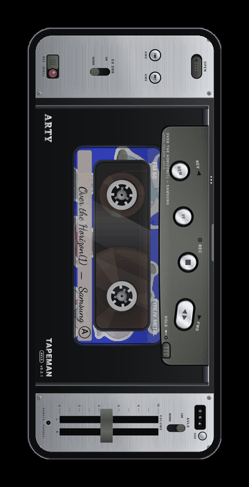
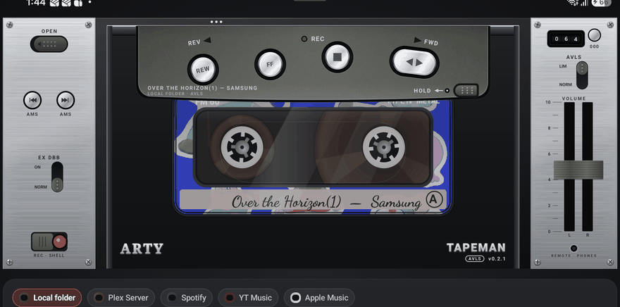
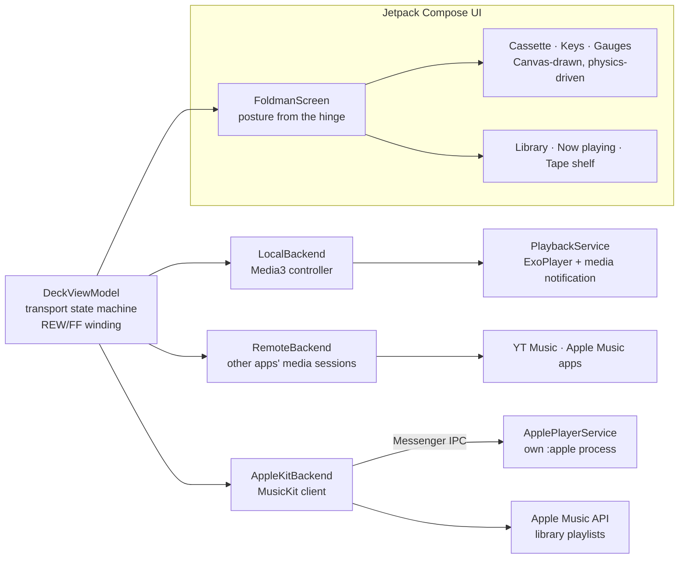

<p align="center">
  
</p>

<p align="center">
  <a href="https://github.com/deveshrai/Foldman/releases/latest"></a>
  <a href="LICENSE"></a>
  
  
</p>

<p align="center"><b>Foldman turns a folding phone into a Sony Walkman WM-RX707 cassette player.</b><br>
Folded on a 21:9 cover screen (like the Galaxy Z Fold 8 Ultra), it's a sideways horizontal WM-RX707 with feather-touch spun-chrome logic controls, a curved hammer-tone gunmetal control pod, and a transparent Sony MA-XG46 Metal tape.<br>
Unfold it and it lays down into a full stereo deck with twin VU meters, EX DBB bass boost, and AVLS.<br>
Stream directly from your <b>Plex Media Server</b>, browse and control <b>Spotify</b>, play local music files, or drive YT Music and Apple Music.</p>

<p align="center">
  <a href="https://github.com/deveshrai/Foldman/wiki"><b>📖 Wiki</b></a> ·
  <a href="https://github.com/deveshrai/Foldman/wiki/Using-Foldman">Using Foldman</a> ·
  <a href="https://github.com/deveshrai/Foldman/wiki/Troubleshooting">Troubleshooting</a> ·
  <a href="CHANGELOG.md">Changelog</a> ·
  <a href="PRIVACY.md">Privacy</a> ·
  <a href="CONTRIBUTING.md">Contributing</a>
</p>

---

<p align="center">
  
</p>

## The tape moves the way the keys say

Every key is a latching mechanism, and the cassette behind the window follows it, frame by frame.

| Key | What the mechanism does | What you see |
| --- | --- | --- |
| **PLAY** | Latches down, tape runs at 4.76 cm/s | Reels turn at speed ÷ radius: the nearly empty reel spins fast, the full one slowly, and they swap as the song plays. OPERATE LED on. Counter rolls. |
| **PAUSE** | Latches with PLAY still down | Reels hold still. LED blinks slowly. |
| **STOP·EJECT** | Releases everything | Reels coast to a stop. LED off. Press again with the tape stopped and the cassette pops. |
| **FF / REW** | Latches and winds at 12× | Reels spin up with inertia to a motion-blurred blur, the counter races, the LED flickers. The tape winds straight through into the next or previous song, and the auto-stop thunks at the end of the tape. |
| **AMS ⏮ ⏭** | Skips to the previous or next song | |

The keys click (the sounds are synthesised, not samples) and buzz under your thumb. The tape counter is geared to the take-up reel, the VU needles follow the real audio on local files, and the tape packs on the reels show how far through the song you are.

## Folded, unfolded, half-open

Foldman reads the hinge and rebuilds itself for each posture, without stopping the music.

<table>
  <tr>
    <td align="center" width="34%"><br><b>Folded</b><br><sub>An upright portable in blue enamel, edge to edge. The tape stands on end behind a small window; keys, volume and phones socket run down the silver side strip.</sub></td>
    <td align="center" width="66%"><br><b>Unfolded</b><br><sub>The player lies down as a deck: twin VU meters, a mechanical counter, CLICK and HAPTIC switches. Your library is above it, and the cover, up next and liner notes are below.</sub></td>
  </tr>
</table>

<table>
  <tr>
    <td align="center" width="50%"><br><b>Half-open (Flex mode)</b><br><sub>Stand it on a table: the deck takes the top half, the library the bottom.</sub></td>
    <td align="center" width="50%"><br><b>Unfolded, landscape</b><br><sub>On a real Z Fold 8.</sub></td>
  </tr>
</table>

<p align="center">
  
  <br><sub>The deck on a real Z Fold 8: needles swinging, the counter rolling, FF winding the tape on.</sub>
</p>

## Five ways to load a tape

| | Source | How it works |
| --- | --- | --- |
| 🟠 | **Plex Server** | Connect directly to your Plex Media Server (`https://plex.yourserver.com` or any Plex URL + `X-Plex-Token`). Browse **Albums**, **Recent**, **Popular**, and **Playlists** with A–Z jump and search. Streams directly through Foldman's Media3 engine so the **twin VU meters follow the real audio**, **EX DBB** and **AVLS** process the sound in real time, and **12× REVIEW/CUE** winds continuously across tracks. |
| 🟢 | **Spotify** | Drive the Spotify Android app via media-session control out of the box, or sign in via **OAuth 2.0 PKCE** (`foldman://spotify-callback`) to browse your Spotify **Playlists** and **Saved Albums** directly inside Foldman's Tape Shelf and Library Band. |
| 🗂 | **Local folder** | Pick any folder on the phone. MP3, FLAC, M4A, OGG, Opus, WAV and more play through Media3 in the background, with the system media controls and headphone keys. Album art comes from the files' embedded art or a `cover.jpg` / `folder.png` beside them, and each sub-folder becomes an album. |
| 🍎 | **Apple Music** | Sign in through Apple's MusicKit, browse your library playlists inside Foldman, and stream them in-app. Apple's player runs in its own process: if Apple's native code crashes, the music picks up again on the same song a few seconds later, and Foldman never closes. |
| ▶️ | **YT Music** (and Apple Music without MusicKit) | Foldman drives the app's own media session: the keys, REW/FF, skip, artwork on the label and the queue all work on it, and you pick what to play in the app itself. |

The album art is printed on the cassette label, so you only see it around the reels, the way you would on a real tape. Its colours also tint the paper strip with the handwritten title.

## Install

1. Download the **`Foldman-…-release.apk`** from the [latest release](https://github.com/deveshrai/Foldman/releases/latest) and open it on your phone. You'll need to allow installs from your browser or file manager.
2. **For YT Music:** open Foldman → YT Music → *Grant access*. Android only shares other apps' playback with apps that have notification access. If the switch is greyed out, go to **App info → ⋮ → Allow restricted settings** first; Android does this for apps installed outside the Play Store.
3. **For Apple Music:** install Apple Music and sign in with a subscribed Apple ID, then choose Foldman → Apple Music → *Sign in to Apple Music*.

Works on Android 11 and later, on 64-bit ARM phones. It's designed for the Galaxy Z Fold 8 and runs on any foldable or regular phone. Samsung's **Auto Blocker** can stop sideloaded installs, so switch it off in Settings → Security and privacy if the install is refused.

## Build from source

```bash
git clone https://github.com/deveshrai/Foldman.git
cd Foldman
./gradlew :app:assembleDebug
```

You'll need JDK 17+ and the Android SDK (compile SDK 37). The APK lands in `app/build/outputs/apk/debug/`. With no extra setup, local files and YT Music work fully, and Apple Music runs through media-session control.

<details>
<summary><b>Optional: Apple Music inside Foldman (MusicKit)</b></summary>

<br>

Apple ships MusicKit for Android as two AARs that you download with an Apple Developer account. They're not on Maven and aren't in this repo. Foldman finds them at runtime, so the code needs no changes.

1. **Media ID:** at developer.apple.com, go to Certificates, IDs & Profiles → Identifiers → **+** → *Media IDs*, and create one (e.g. `media.your.app`) with **MusicKit** ticked.
2. **Key:** under Keys → **+**, tick *Media Services (MusicKit, ShazamKit, Apple Music Feed)*, configure it with that Media ID, register it, and **download the `.p8`** (Apple only offers it once). Note the Key ID and your Team ID.
3. **Developer token:** copy `apple-music.properties.example` to `apple-music.properties` (git-ignored), fill in the IDs and the path to the `.p8`, then run:
   ```bash
   python3 tools/make_apple_token.py
   ```
   It signs a 180-day token (Apple's maximum is six months) and saves it in that file, and the build bakes it into the app. It needs only the Python and `openssl` that come with macOS.
4. **SDK:** download *Android MusicKit* from [developer.apple.com → Downloads → More](https://developer.apple.com/download/all/?q=android%20musickit), then copy `musickitauth-release-*.aar` and `mediaplayback-release-*.aar` into `app/libs/`.
5. Rebuild.

Never commit the `.p8`. `*.p8`, `apple-music.properties`, `signing.properties` and `app/libs/*.aar` are all git-ignored.

**Notes on Apple's SDK, which dates from 2021:**
- Its sign-in callback screen predates Android 12's rules for screens other apps can open, so Foldman declares it in its manifest.
- Its native code doesn't cope with Android's tagged memory pointers, so Foldman turns those off with `allowNativeHeapPointerTagging="false"`.
- It contains Android Studio's template robot icon under the default icon name, so Foldman's icon layers are named `foldman_icon_*` to keep the robot out.

</details>

Release builds, signing and version numbers are covered in [Release process](https://github.com/deveshrai/Foldman/wiki/Release-process).

## How it's put together



- **[`ui/ReelMotion.kt`](app/src/main/java/dev/foldman/ui/ReelMotion.kt):** the tape transport as a small physics model. Tape speed is constant, so each reel turns at *v ÷ r*; pack radii follow conservation of tape area, and the reels spin up and coast down.
- **[`ui/Cassette.kt`](app/src/main/java/dev/foldman/ui/Cassette.kt):** the cassette, drawn in millimetres to the real 100.4 × 63.8 mm Compact Cassette and seen through the case window.
- **[`deck/DeckViewModel.kt`](app/src/main/java/dev/foldman/deck/DeckViewModel.kt):** keys → transport state (stop vs. pause latches, winding through songs, auto-stop).
- **[`apple/`](app/src/main/java/dev/foldman/apple):** MusicKit reached by reflection (so the app builds without Apple's SDK), the Apple Music API client, and the crash-isolated player service.
- **[`art/icon.svg`](art/icon.svg):** the launcher icon's source. Run `python3 tools/svg_to_icon.py` to regenerate the adaptive and themed icon layers.

## Known limitations

- **In-app Apple Music isn't a background service yet.** It has no lock-screen controls, and Android may stop it if Foldman stays in the background for a long time. Local music doesn't have this problem.
- **Another app taking over the audio stops Foldman.** Opening the Apple Music app, for example, can resume its own song; press PLAY in Foldman to take the audio back.
- **The developer token in release builds expires on 19 April 2027.** In-app Apple Music stops working after that until there's a new release. Driving the Apple Music app keeps working.
- **Streaming sources:** pick music inside YT Music or the Apple Music app (Foldman browses only your Apple Music *library* playlists). REW/FF winds within the current song: rewinding stops at its start, and fast-forwarding past its end skips to the next song and stops. The VU needles animate rather than reading the audio, because Android doesn't let one app read another's.
- Songs you uploaded to Apple Music yourself can't be streamed through MusicKit; they're greyed out.
- Tags (title and artist) are read for the first 600 local files; files after that show their file names.

More detail is in the wiki under [Sources](https://github.com/deveshrai/Foldman/wiki/Sources) and [Troubleshooting](https://github.com/deveshrai/Foldman/wiki/Troubleshooting).

## Roadmap

- [ ] Background playback for in-app Apple Music (a foreground service with a media notification)
- [ ] Side B: auto-reverse at the end of a playlist
- [ ] Tape hiss and wow-and-flutter as optional effects
- [ ] More shell colours and cassette types (chrome, metal)

Ideas and bug reports are welcome in [Issues](https://github.com/deveshrai/Foldman/issues).

## License

Foldman is released under the [Apache License 2.0](LICENSE). You can use, change and redistribute it, including commercially, but you must keep the copyright notice and the [NOTICE](NOTICE) file crediting the original project.

Copyright © 2026 [Devesh Rai](https://github.com/deveshrai).

<sub>Foldman is an independent project, not affiliated with or endorsed by Sony, Apple, Google or Samsung. "Walkman" is a trademark of Sony; Apple Music and MusicKit are trademarks of Apple; YouTube Music is a trademark of Google; Galaxy Z Fold is a trademark of Samsung. Release builds include Apple's MusicKit for Android SDK, used under the Apple Developer Program License Agreement; it is not part of this repository's source.</sub>
