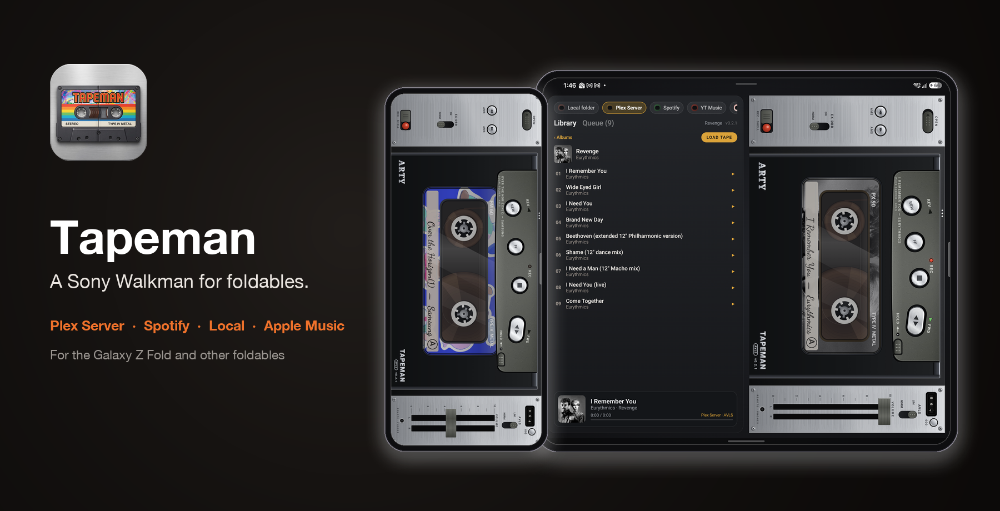
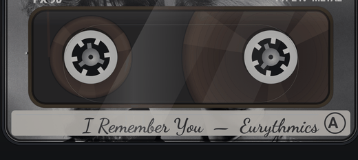
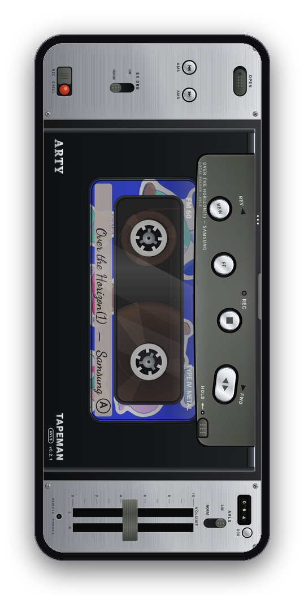
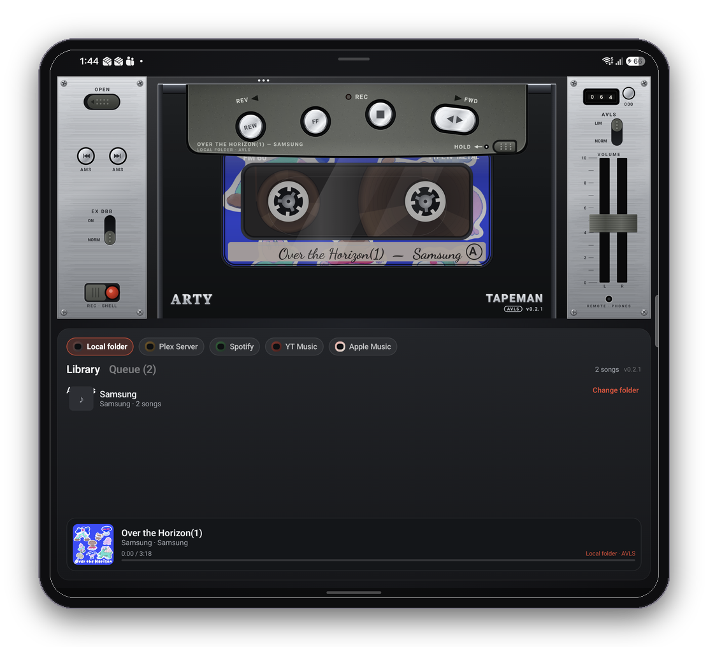
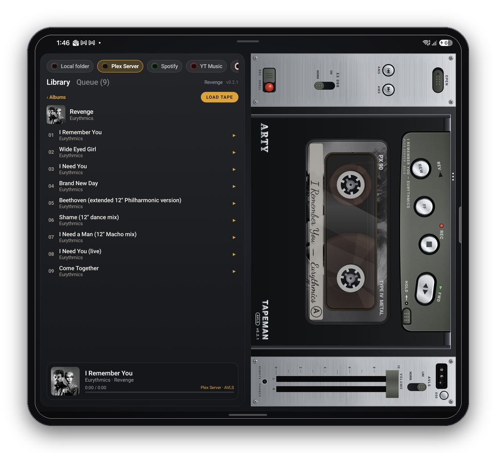
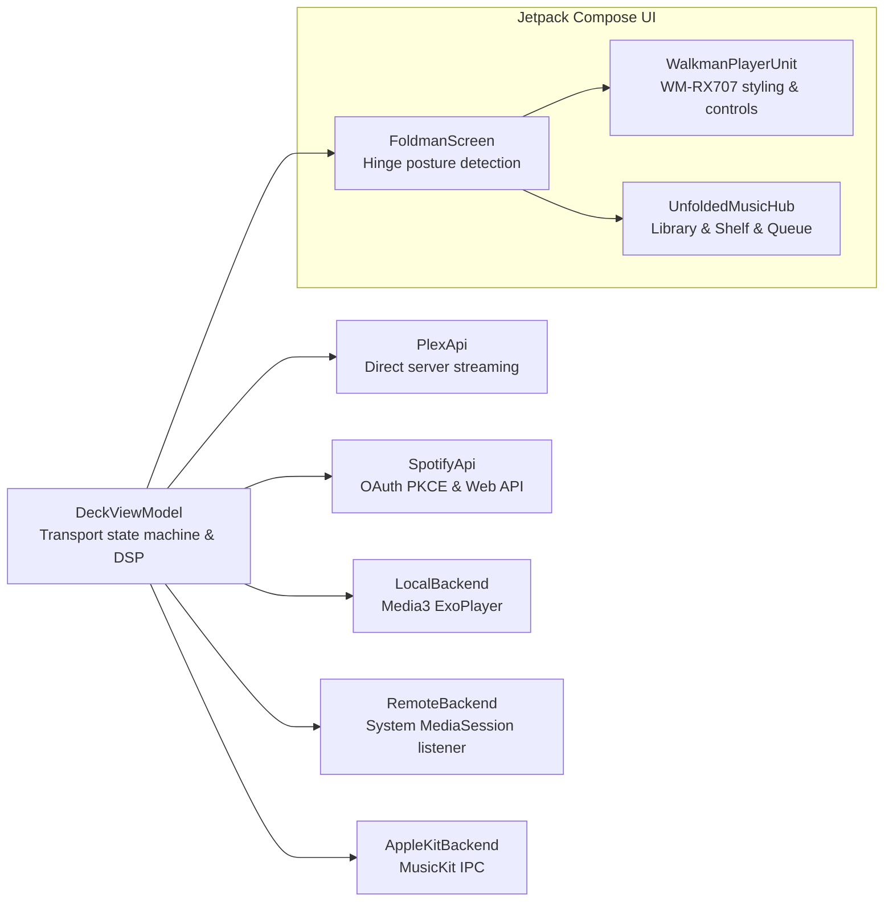

<p align="center">
  
</p>

<p align="center">
  <a href="https://github.com/artywah/Tapeman/releases/latest"></a>
  <a href="LICENSE"></a>
  
  
</p>

<p align="center"><b>Tapeman turns a folding phone into a Sony Walkman WM-RX707 cassette player.</b><br>
Folded on a 21:9 cover screen (like the Galaxy Z Fold), it's a sideways horizontal WM-RX707 with feather-touch spun-chrome logic controls, a curved hammer-tone gunmetal control pod, and a transparent Type IV Metal tape.<br>
Unfold it and it lays down into a full studio deck with brushed aluminium plates, master stereo faders, mechanical 3-digit tape counter, real-time EX DBB dynamic bass boost, and AVLS limiter.<br>
Stream directly from your <b>Plex Media Server</b>, browse and control <b>Spotify</b>, play local music files, or drive YT Music and Apple Music.</p>

<p align="center">
  <a href="CHANGELOG.md"><b>Changelog</b></a> ·
  <a href="PRIVACY.md">Privacy</a> ·
  <a href="CONTRIBUTING.md">Contributing</a> ·
  <a href="LICENSE">License</a>
</p>

---

<p align="center">
  
</p>

## The tape moves the way the keys say

Every key is a physical latching mechanism, and the cassette behind the glass window follows it frame by frame.

| Key | What the mechanism does | What you see |
| --- | --- | --- |
| **FWD ▶ / REV ◀** | Latches down, tape runs at 4.76 cm/s | Direction indicator illuminates. Reels turn at speed ÷ radius: the nearly empty reel spins fast, the full one slowly, and they swap as the song plays. REC indicator lit. Counter rolls. |
| **STOP ■** | Releases transport mechanism | Reels coast to a stop with realistic physical inertia. Motor stops. Press again with tape stopped to pop open the cassette door. |
| **FF ⏩ / REW ⏪** | Latches and winds at 12× | Reels spin up with inertia to a blur, counter races, and 12× REVIEW/CUE winds smoothly through and across songs. Auto-stop clicks cleanly at the end of the tape. |
| **AMS ⏮ ⏭** | Automatic Music Sensor | Skips immediately to the previous or next track on the tape. |
| **OPEN ⏏** | Ejects the cassette | Cassette door swings open to reveal the internal transport bay and tape well. |

The tactile keys produce synthesized analog mechanical clicks and subtle haptic feedback under your thumb. The mechanical tape counter increments with the take-up reel, stereo volume faders give precise gain control, and the cassette packs visually reflect your exact playback position.

---

## Folded, unfolded, half-open

Tapeman dynamically reads the device hinge and posture, adapting its interface seamlessly without interrupting playback.

<table>
  <tr>
    <td align="center" width="34%"><br><b>Folded (Cover screen)</b><br><sub>The Sony Walkman WM-RX707 edge-to-edge. Spun-chrome logic controls, brushed metal side panels, EX DBB and AVLS switches, dual volume faders, and a transparent Type IV Metal tape behind the viewing window.</sub></td>
    <td align="center" width="66%"><br><b>Unfolded (Main display)</b><br><sub>A full dual-panel studio stereo deck alongside your music library. Browse Plex, Spotify, or local storage on the left, while operating the WM-RX707 deck on the right.</sub></td>
  </tr>
</table>

<table>
  <tr>
    <td align="center" width="50%"><br><b>Half-open (Flex mode / Tabletop)</b><br><sub>Stand your phone on a table: the WM-RX707 deck occupies the top half at an optimal viewing angle, while library navigation and queue remain accessible below.</sub></td>
    <td align="center" width="50%"><br><b>Unfolded (Landscape)</b><br><sub>Widescreen view with full track queue details, album artwork, and complete deck controls.</sub></td>
  </tr>
</table>

---

## Five ways to load a tape

| | Source | How it works |
| --- | --- | --- |
| 🟠 | **Plex Media Server** | Connect directly to your Plex Media Server (e.g. `https://plex.yourserver.com` + `X-Plex-Token`). Browse **Artists**, **Albums**, **Recent**, **Popular**, and **Playlists** with full discography drill-down, infinite scrolling, instant A–Z jump rails, and debounced live search. Streams directly through Tapeman's native Media3 audio engine with real-time **EX DBB dynamic bass boost**, **AVLS limiter**, continuous 12× REVIEW/CUE winding across tracks, and album art printed directly onto the cassette tape label. |
| 🟢 | **Spotify** | Drive Spotify via media-session control out of the box, or sign in securely via **OAuth 2.0 PKCE** to browse your Spotify **Playlists** and **Saved Albums** directly inside Tapeman's Tape Shelf and Library Band. |
| 🗂 | **Local folder** | Pick any folder on the phone. Plays FLAC, MP3, AAC, M4A, OGG, Opus, WAV and more via Media3 in the background with lock screen controls and system media notifications. Embedded art or `cover.jpg` / `folder.png` is stamped onto the cassette label. |
| 🍎 | **Apple Music** | Sign in through Apple's MusicKit to browse library playlists inside Tapeman and stream them in-app via a crash-isolated player service. |
| ▶️ | **YT Music** (and other players) | Tapeman hooks into the system media session to drive playback, skip tracks, and display live artwork on the cassette label. |

---

## Real-Time Audio DSP

Tapeman incorporates authentic audio processing inspired by high-end portable cassette players:
- **EX DBB (Dynamic Bass Boost):** Dual-mode frequency equalization providing rich low-end resonance and analog tape warmth.
- **AVLS (Automatic Volume Limiter System):** Dynamic range compression that prevents harsh peaks and protects listening levels without distorting transients.
- **Physical Volume Faders:** Tactile dual-slider master gain control.

---

## Installation

1. Download the latest **`Tapeman-…-release.apk`** from [Releases](https://github.com/artywah/Tapeman/releases/latest) and open it on your device.
2. **For Streaming Apps (Spotify / YT Music / Apple Music without MusicKit):** Grant notification access when prompted so Tapeman can bind to active media sessions.
3. **For Plex Server:** Enter your server URL and `X-Plex-Token` in the Plex configuration dialog to sync your music library.
4. **For Local Music:** Choose a local music directory with the system storage picker.

> Compatible with Android 11+ on 64-bit ARM devices (optimized for Samsung Galaxy Z Fold series, Pixel Fold, and OnePlus Open). If Samsung Auto Blocker blocks the APK installation, temporarily disable it in **Settings → Security and privacy → Auto Blocker**.

---

## Building from source

```bash
git clone https://github.com/artywah/Tapeman.git
cd Tapeman
./gradlew :app:assembleDebug
```

Requirements:
- JDK 17+
- Android SDK (compileSdk 37, minSdk 30)

The generated debug APK will be located at:
```
app/build/outputs/apk/debug/Tapeman-0.2.1-debug.apk
```

<details>
<summary><b>Optional: Apple Music inside Tapeman (MusicKit)</b></summary>

Apple provides MusicKit for Android as AAR libraries via the Apple Developer Portal:
1. **Media ID & Key:** Create a Media ID and MusicKit Private Key (`.p8`) on [developer.apple.com](https://developer.apple.com).
2. **Developer Token:** Copy `apple-music.properties.example` to `apple-music.properties`, insert your IDs and path to the `.p8`, and run:
   ```bash
   python3 tools/make_apple_token.py
   ```
3. **AAR Libraries:** Place `musickitauth-release-*.aar` and `mediaplayback-release-*.aar` into `app/libs/`.
4. Rebuild the project.

</details>

---

## Architecture



Key Source Modules:
- [`ui/FoldmanScreen.kt`](app/src/main/java/dev/foldman/ui/FoldmanScreen.kt): Posture adaptation (Cover, Unfolded, Tabletop) based on `WindowLayoutInfo` and `FoldingFeature`.
- [`ui/WalkmanPlayerUnit`](app/src/main/java/dev/foldman/ui/FoldmanScreen.kt): High-fidelity Sony Walkman WM-RX707 unit with brushed aluminium panels, hammer-tone pod, and spun-chrome controls.
- [`ui/Cassette.kt`](app/src/main/java/dev/foldman/ui/Cassette.kt): Compact Cassette physical model (Type IV Metal / FM 60 / PX 90) with real-time reel mechanics and tape path.
- [`ui/Controls.kt`](app/src/main/java/dev/foldman/ui/Controls.kt): Analog controls, volume fader pots, EX DBB and AVLS toggles, and mechanical counter.
- [`ui/Panels.kt`](app/src/main/java/dev/foldman/ui/Panels.kt): Brushed metal textures, bevels, screws, and surface materials.
- [`deck/DeckViewModel.kt`](app/src/main/java/dev/foldman/deck/DeckViewModel.kt): Unified transport state machine, EX DBB / AVLS audio filters, and multi-source routing.
- [`spotify/SpotifyApi.kt`](app/src/main/java/dev/foldman/spotify/SpotifyApi.kt): Spotify Web API client with OAuth 2.0 PKCE authentication.

---

## Roadmap

- [x] Sony Walkman WM-RX707 industrial recreation with spun-chrome feather-touch controls
- [x] Direct Plex Media Server streaming with live library browsing and search
- [x] In-app Spotify library browsing and playback control via OAuth 2.0 PKCE
- [x] Real-time EX DBB (Dynamic Bass Boost) and AVLS audio processing
- [x] Type IV Metal transparent cassette styling with custom labels and moving tape packs
- [x] Interactive Tabletop (Flex mode) layout for foldables
- [ ] Background playback for in-app Apple Music
- [ ] Auto-reverse Side B transition at playlist end
- [ ] Tape hiss and wow-and-flutter DSP emulation

---

## License & Credits

Tapeman is released under the [Apache License 2.0](LICENSE).

Derivative work based on Foldman, Copyright © 2026 [Devesh Rai](https://github.com/deveshrai).  
Redistributions and modifications retain the copyright notices and [NOTICE](NOTICE) file.

<sub>Tapeman is an independent project, not affiliated with or endorsed by Sony, Apple, Spotify, Plex, Google, or Samsung. "Walkman" is a trademark of Sony Group Corporation. All other trademarks belong to their respective owners.</sub>
